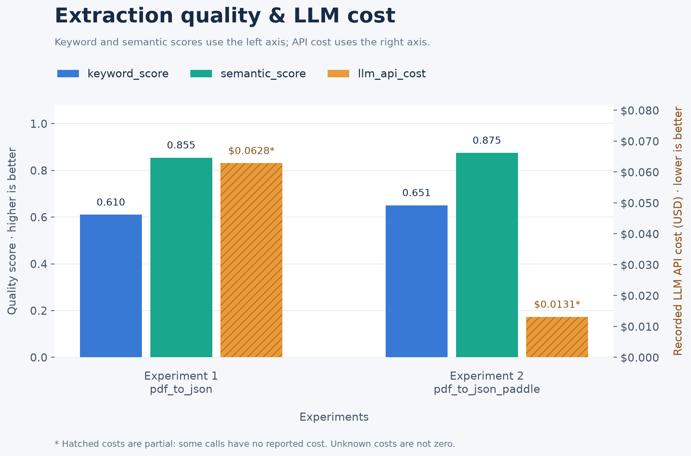
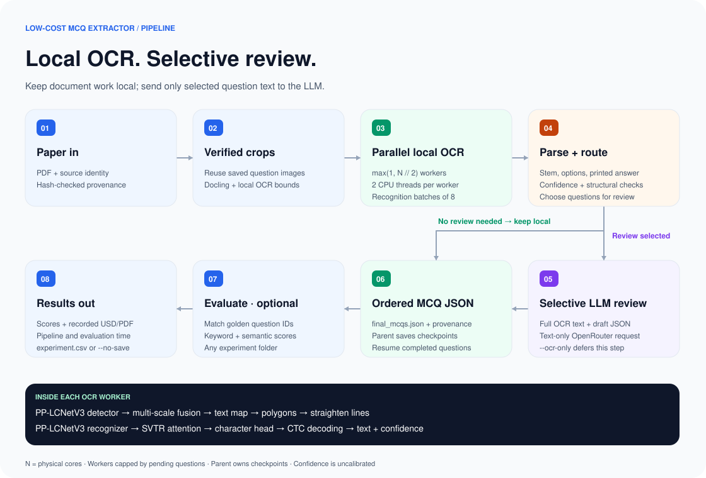

# Low-Cost MCQ Extractor

Turn question-paper PDFs into structured MCQ JSON using local OCR and selective
text-only LLM review. The primary implementation is
[`src/mcq_extractor`](src/mcq_extractor): it extracts question text, four
options, printed answers, explanations, and source references while retaining
question crops for inspection.

**Work in progress.** Current experiments use NEET papers from 2021–2025.
Extraction quality, formula recognition, and review routing are still being
improved. Printed answers are transcribed from the supplied paper or solutions.

## Results

The latest **local OCR + LLM call** run extracts **978 of 980 questions** across
the 2021–2025 NEET papers at **$0.01868 recorded LLM cost per PDF**.
That is **55.3% lower recorded cost/PDF** than the original method, with an
aggregate score of **0.7614**, compared with **0.7663** for the original method.



**Cost coverage:** the latest local and original runs both have recorded costs
for all five PDFs, but 47 of 501 local-method calls and 53 of 427 original-method
calls have no reported cost. These values are recorded API-cost subtotals,
averaged per PDF; local compute is excluded. The initial run had costs for
four of five PDFs. Pipeline runtime is recorded for only one of five PDFs in
the latest local run, so the saved data does not establish a full-run speed comparison.

Keyword scoring uses exact matching word prefixes, so an early punctuation,
Unicode, or LaTeX difference can stop a field’s score. Missing questions score
zero. These metrics measure text similarity rather than verified answer accuracy.
See [evaluation details](docs/evaluation.md) for scoring and coverage rules.

The chart uses existing saved experiments; no evaluations were rerun.

## Pipeline design

[](docs/low-cost-mcq-extractor.drawio)

## Install from PyPI

Once the first release is published:

```bash
python -m pip install mcq-extractor
mcq-extract paper.pdf --output outputs/my-paper --ocr-only
```

Install `mcq-extractor[eval]` for evaluation and plots. The package includes the
main OCR and crop dependencies; experimental versions remain in this repository.
For Apple GPU inference, add `--device mps --workers 1`. On Linux, add
`--crop-ocr hf --device auto`. Installed commands use the working directory for
`.env` and default outputs; `MCQ_WORKSPACE` overrides that location.

## Setup from source

Use Python 3.10 or newer from the repository root:

```bash
python3 -m venv .venv
source .venv/bin/activate
python -m pip install -e '.[ocr,crop,eval]'
```

Crop generation selects Apple Vision on macOS and native PP-OCRv5 on Linux,
including Colab. Linux Docling conversion uses RapidOCR's PyTorch backend.
To process already generated crops, install `.[ocr,eval]` and pass `--crops-dir`.
Model weights download on first use and are cached. `--local-files-only` requires
the native OCR models to be fully cached.

For selected LLM review, create a root `.env` with your own key:

```dotenv
OPENROUTER_API_KEY=your-key
OPENROUTER_MODEL=google/gemini-2.5-flash-lite
```

The native pipeline loads this file. Local OCR with `--ocr-only` works without
an API key.

### Apple / macOS

The setup above installs Apple Vision for crop generation. Run the main OCR
stage on the Apple GPU when PyTorch reports MPS available:

```bash
python -c "import torch; print('MPS available:', torch.backends.mps.is_available())"

bash src/mcq_extractor/run.sh dataset/pdfs/2021.pdf \
  --crop-ocr vision --device mps --workers 1 --ocr-only \
  --output outputs/apple_mps
```

Use `--device cpu` if MPS is unavailable. Remove `--ocr-only` to enable selected
LLM review after configuring `.env`.

### Linux

Use the same virtual environment and installation commands above. Select native
PP-OCRv5 for crop generation; `auto` uses CUDA when available and CPU otherwise:

```bash
bash src/mcq_extractor/run.sh dataset/pdfs/2021.pdf \
  --crop-ocr hf --crop-device auto --device auto --ocr-only \
  --output outputs/linux_ocr
```

For CPU execution, set both `--crop-device cpu` and `--device cpu`. Remove
`--ocr-only` to enable selected LLM review after configuring `.env`.

### Google Colab

After updating the cloned repository, install dependencies in a notebook cell:

```python
%cd /content/mcq-extractor
%pip install -e '.[ocr,crop,eval]'
```

Run from the PDF alone, using a fresh output directory:

```python
!DOCLING_PYTHON=python \
  MCQ_OUTPUT=/content/mcq-extractor/outputs/json_crops_my_all \
  bash /content/mcq-extractor/src/mcq_extractor/run.sh \
  /content/mcq-extractor/dataset/2023.pdf \
  --crop-ocr hf
```

This creates crops, runs native OCR, and reviews selected questions when the
OpenRouter key is configured. Add `--ocr-only` for local work only. No saved
crops or macOS libraries are needed. `--crop-device cpu` forces CPU crop checks;
the default `auto` selects CUDA when available. The native OCR stage has its
own `--device` setting. Initial model downloads require network access.

## Extract a PDF

Start with two questions and local OCR only:

```bash
MCQ_OUTPUT=outputs/my_first_run \
  bash src/mcq_extractor/run.sh dataset/pdfs/2021.pdf --ocr-only --limit 2
```

Continue the remaining OCR and review selected questions:

```bash
MCQ_OUTPUT=outputs/my_first_run \
  bash src/mcq_extractor/run.sh dataset/pdfs/2021.pdf --resume
```

To reuse saved crops explicitly:

```bash
.venv/bin/python -m mcq_extractor dataset/pdfs/2021.pdf \
  --crops-dir outputs/json_crops_fast/2021 \
  --output outputs/my_crop_run --ocr-only
```

Choose a fresh output directory when PDF, OCR settings, or checkpointed code
changes. `--resume` verifies saved inputs and artifacts. The shell script defaults
to the 2021 PDF and `outputs/native_ocr`; `MCQ_OUTPUT` sets the
experiment folder. See the [native pipeline guide](src/mcq_extractor/README.md)
for concurrency, profiling, local models, and labeling export.

## Output format

Both methods publish the same public JSON filenames:

```text
outputs/<experiment>/<PDF-name>/
├── mcqs.json                 # Local or heuristic drafts
├── final_mcqs.json           # Final extraction and review status
├── pipeline.json             # Identity, crop plan, checkpoints, worker metadata
├── runtime.json              # Recorded pipeline wall-time sessions
└── questions/                # Native pipeline's per-question evidence
    └── <question-key>/
        ├── patch.png
        ├── part_01.png
        ├── paddle_ocr.json    # Native OCR lines, boxes, scores, and timing
        ├── paddle_ocr.txt
        └── mcq.json
```

Question records preserve source crops, page references, routing reasons, and
review flags. The original method also retains its raw Docling data and legacy
intermediate folders. `runtime.json` is available for runs made with timing
support; historical durations can remain unknown.

## Evaluate and plot

Provide an experiment folder; golden references default to `dataset/golden`:

```bash
.venv/bin/python -m mcq_extractor.evaluation outputs/json_crops_my_all
.venv/bin/python -m mcq_extractor.evaluation outputs/pdf_to_jsons_all
```

Each command discovers available PDFs and appends one row to
`results/experiment.csv`. An optional second folder selects the golden dataset.
Use `--no-save` to print results without writing a row:

```bash
.venv/bin/python -m mcq_extractor.evaluation outputs/my_first_run dataset/golden --no-save
.venv/bin/python -m mcq_extractor.evaluation outputs/json_crops_my_all --years 2023 --no-save
```

Reports include quality scores, average recorded cost/PDF, cost coverage,
available pipeline wall time, and separate evaluation duration. Folder discovery
includes only available PDFs unless `--years` explicitly requests missing years.
The first evaluation may download the embedding model; `--local-files-only`
uses cached weights.

```bash
.venv/bin/python -m mcq_extractor.evaluation.plot_experiments
# Optional vector export:
.venv/bin/python -m mcq_extractor.evaluation.plot_experiments --output results/experiments.svg
```

The chart reads `results/experiment.csv` and defaults to
`results/experiments.png`. See [evaluation documentation](docs/evaluation.md).

## Other methods and development

- [Native local OCR pipeline](src/mcq_extractor/README.md): primary low-cost path.
- [Paddle pipeline](experiments/paddle/README.md): Paddle mobile and VL backends.
- [Original pipeline architecture](docs/architecture.md): Docling conversion,
  heuristic extraction, and vision review.
- [Crop engine](docs/crop-pipeline.md) and [hybrid review](docs/hybrid-review.md).

The original method remains available through `python -m experiments.docling` and
`experiments/docling/run.sh`.

```bash
PYTHONPATH=src:. .venv/bin/python -m unittest discover -s tests -p 'test_*.py'
```

Tests use offline fixtures and mocked external calls. Extraction can still miss
text, confuse option labels, or alter formulas; inspect uncertain questions
against their saved images before using the JSON as verified data.

## Repository layout

```text
src/
└── mcq_extractor/           # Maintained native OCR pipeline
    ├── run.sh              # Main PDF launcher
    ├── document/           # Shared Docling conversion and crop engine
    └── evaluation/         # Scoring and experiment plots
experiments/
├── docling/                # Original heuristic extraction and vision review
│   └── run.sh              # Convert a directory of PDFs
├── vision/                 # Crop-only vision LLM pipeline
│   └── run.sh
├── paddle/                 # Paddle mobile and vision-language alternatives
│   └── run.sh
├── precision/              # FP16 checkpoint conversion
└── recognition/            # Recognition multiprocessing benchmark
```

Run shell commands from the repository root. The main package is
`mcq_extractor`; alternate pipelines run as `python -m experiments.<version>`.
See [experiment commands](experiments/README.md). Existing datasets, output
folders, CSV results, and historical method identifiers retain their names.
